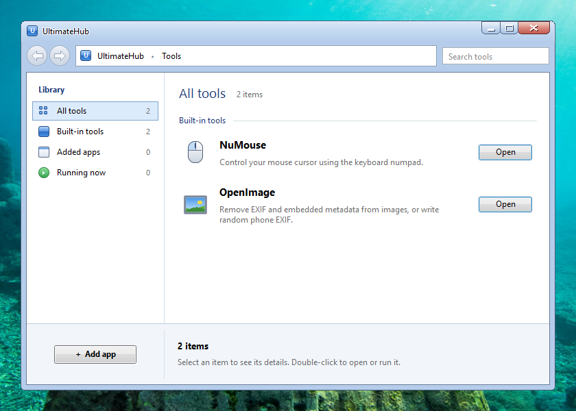
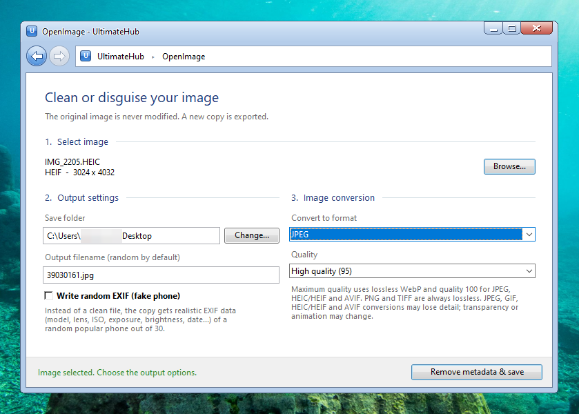

# UltimateHub

A single-file Windows launcher with a Windows 7 "Aero" look. It bundles two small tools and lets you add any `.exe` to a Steam-library-style list.

Everything lives in one file: `UltimateHub.pyw`.

## Screenshots





## Features

**Hub**
- Windows 7 Aero styled window (glass title bar, Explorer-like navigation pane, details pane).
- **Add app**: pick any `.exe`; it is added with its icon and gets **Run** and **Delete** buttons. Delete only removes the entry, never the program.
- Search and filters (all / built-in / added apps / running).

**NuMouse**: control the mouse cursor with the numpad.
- Runs as a background helper: leaving its page does not stop it. Use **Stop** on its row or page.
- `Num -` toggles control, `8/2/4/6` move, `7/9/5` hold left/right/middle button, `0` slow, `3` and `,` scroll.
- While control is on, the keys it uses are blocked from other programs. NumLock must be on.

**OpenImage**: image privacy tool.
- Removes EXIF and other embedded metadata (JPEG and PNG are cleaned losslessly, without re-compression).
- Converts between JPEG, PNG, WebP, TIFF, BMP, GIF, HEIC/HEIF and AVIF.
- **Write random EXIF**: instead of leaving the file clean, it writes realistic EXIF of a random phone out of 30 built-in models (model, lens, ISO, exposure, brightness, date...). The goal is privacy: hiding your real device. The values are generated to be consistent with each other, but it is not a perfect forgery (for example, vendor MakerNote data is not included).
- **Slightly reduce the resolution** (available together with random EXIF): shrinks the picture a little, e.g. 3024 x 4032 becomes 3000 x 4000, so the original device's native size does not give it away. The aspect ratio is kept and nothing is cropped. JPEG and PNG are re-encoded in this case, and only Android phones are picked for the random EXIF (an iPhone photo would normally not have a reduced size).
- **Add random location (on land)** (available together with random EXIF): writes a random GPS position that is always on land. It is never in the sea, in a big lake, in Antarctica or on the Greenland ice sheet. The time zone, the GPS time and the EXIF offset follow the place (including summer time in Europe and North America). About 70 % of the spots are near inhabited areas, the rest can be anywhere on land. The location is always random, you cannot type coordinates. The land data is embedded in the script, no internet is needed.

## Requirements

- Windows 10 / 11, Python 3.8+
- `pip install -r requirements.txt`

## Run

Double-click `UltimateHub.pyw`. The `.pyw` extension makes Windows start it without a console window.

For debugging you can also run it from a terminal: `python UltimateHub.pyw`.

## Build an .exe (optional)

```
pip install pyinstaller
pyinstaller --noconfirm --windowed --name UltimateHub UltimateHub.pyw
```

Antivirus software sometimes flags keyboard-hook tools like NuMouse in packaged builds. The `onedir` build above (the default) triggers fewer warnings than `--onefile`.

## Notes

- Added apps, their icons and tool logs are stored next to the script in `hub_data/`.
- The background picture and the map data are embedded in the script. No image or data file is needed next to it.
- If the custom window frame misbehaves on your system, set `USE_AERO_FRAME = False` near the top of the file to use the normal Windows title bar.

## License

MIT
